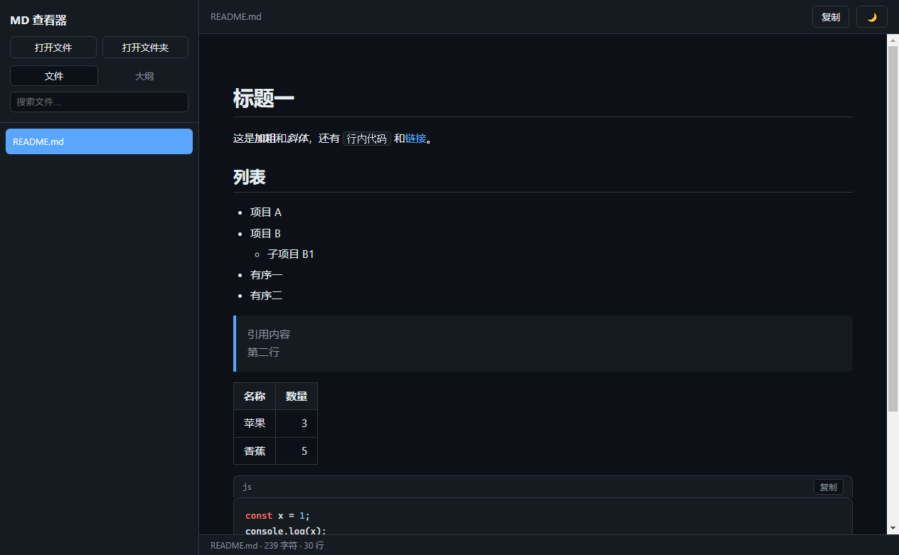

# MD Viewer

[](https://github.com/2642086672/markdown-viewer/actions/workflows/build.yml)
[](https://github.com/2642086672/markdown-viewer/releases/latest)

一款轻量、纯本地的 Markdown 阅读器，提供 **Electron** 与 **Tauri** 两个版本，支持 Windows 与 macOS。两个版本共用同一套界面与功能代码。


<details>
<summary>暗色主题截图</summary>



</details>

## 功能

- **完整 Markdown 渲染**：标题、列表、表格、代码块高亮、引用、任务列表、图片、链接
- **灵活复制**（v1.1.0 新增）：工具栏「复制」支持两种格式、两种范围
  - 复制 Markdown：整篇文档复制原始源文；选中内容时从渲染结果还原 Markdown
  - 复制纯文本：不带任何 Markdown 标记，保留段落、列表符号与表格
  - 有选中文字时只复制选中部分，否则复制整篇文档
- **文件夹模式**：文件列表、大纲导航、文件名搜索
- **本地图片**：自动解析 Markdown 中的相对路径图片，无需联网
- **明暗主题**：一键切换，记忆偏好
- **代码块复制**：每个代码块都有独立复制按钮
- **拖拽打开**：把 `.md` 文件或整个文件夹拖进窗口即可
- **纯本地**：不联网、不上传任何内容

## 两个版本

| 版本 | 外壳 | 安装包 | 说明 |
| --- | --- | --- | --- |
| MD Viewer | Electron（自带 Chromium） | 约 108–115 MB | 渲染环境完全自包含 |
| **MD Viewer Lite** | Tauri（系统 WebView） | **约 2–3 MB** | 体积小，推荐日常使用 |

两个版本功能一致：Markdown 渲染、文件夹/大纲、代码高亮、复制 Markdown/纯文本、拖拽打开、文件关联。

## 下载

前往 [Releases](https://github.com/2642086672/markdown-viewer/releases/latest) 下载：

| 版本 | 平台 | 文件 |
| --- | --- | --- |
| MD Viewer（Electron） | Windows x64 | `MD-Viewer-1.2.0-x64.exe` |
| | macOS Intel (x64) | `MD-Viewer-1.2.0-x64.dmg`（或 `-x64.zip`） |
| MD Viewer Lite（Tauri） | Windows x64 | `MD-Viewer-Lite-1.2.0-x64.exe` |
| | macOS Intel (x64) | `MD-Viewer-Lite-1.2.0-x64.dmg` |

### 关于体积

**MD Viewer Lite（Tauri）** 不打包 Chromium，直接使用系统 WebView（Windows WebView2 / macOS WKWebView）：Windows 安装包约 **2 MB**，macOS dmg 约 **3 MB**，安装后约 10 MB。

**MD Viewer（Electron）** 会把 Chromium 内核和 Node.js 一起打包，基础体积就在 100 MB 左右。1.1.1 已做体积优化：Electron 语言包从 55 套裁剪到 2 套（`zh-CN`、`en`），安装包启用 `maximum` 压缩，macOS DMG 改用 `ULFO` 格式。

| Electron 文件 | 1.1.0 | 1.1.1 |
| --- | --- | --- |
| Windows x64 `.exe` | 115.7 MB | **107.7 MB** |
| macOS Intel `.dmg` | 118.9 MB | **114.6 MB** |
| macOS Intel `.zip` | 115.6 MB | **113.2 MB** |

安装后仅语言包一项就少占用约 39 MB（从 40.3 MB 降到 1.4 MB）。项目自己的 `app.asar` 只有约 0.1 MB，其余都是 Electron/Chromium 运行时。

### macOS 说明

两个版本的安装包都没有 Apple 开发者签名和公证（`未签名`）。首次打开时 macOS 会拦截，请任选其一：

1. 在 Finder 中右键点击 App →「打开」→ 再次确认「打开」
2. 或执行：

```bash
# Electron 版
xattr -dr com.apple.quarantine "/Applications/MD Viewer.app"

# Tauri 版
xattr -dr com.apple.quarantine "/Applications/MD Viewer Lite.app"
```

## 使用

- 点击「打开文件」/「打开文件夹」，或直接拖入文件（夹）
- 工具栏「复制」→「复制 Markdown」或「复制纯文本」
- 内容区选中文字后，复制菜单会变成仅复制选中部分
- 快捷键：`Ctrl/Cmd+O` 打开文件，`Ctrl/Cmd+Shift+O` 打开文件夹，`Ctrl/Cmd+T` 切换主题

## 开发

需要 Node.js 20+。

```bash
npm install
npm start
```

## 构建

### Electron 版

```bash
npm run dist:win        # Windows x64 安装包（NSIS）
npm run dist:mac-x64    # macOS Intel (x64) dmg + zip（需在 macOS 环境执行）
npm run dist:mac-arm64  # macOS Apple Silicon
```

### Tauri 版（MD Viewer Lite）

需要 Rust 1.90+、Node.js 20+，以及平台 WebView（Windows WebView2 / macOS WKWebView）。

```bash
npm run tauri:dev       # 开发模式
npm run tauri:build     # 构建当前平台安装包
```

GitHub Actions 会在推送 `v*` 标签时自动构建两个版本的 **Windows x64** 与 **macOS Intel (x64)** 安装包，并把它们附加到同一个 GitHub Release。

## 项目结构

```
├─ main.js               # Electron 主进程、菜单、文件读取 IPC
├─ preload.js            # Electron 安全桥接（contextIsolation）
├─ md-viewer.html        # 两个版本共用的界面、Markdown 渲染与复制逻辑
├─ tauri-shim.js         # 把 Tauri API 适配成 electronAPI（Electron 下自动跳过）
├─ src-tauri/            # Tauri 外壳：Rust 命令、文件关联、打包配置
├─ scripts/prepare-tauri.mjs  # 构建前复制共享 UI 到 src-tauri/ui
├─ assets/icon.png       # Electron 运行时窗口图标
├─ build/icon.png        # 打包图标（1024×1024）
├─ .github/workflows/    # CI：Electron + Tauri，Windows + macOS Intel
└─ docs/                 # 截图等文档资源
```

## English

MD Viewer is a lightweight, fully local Markdown viewer available in two flavors: **Electron** and **Tauri** (MD Viewer Lite), for Windows and macOS. Both share the same UI and features.

Version 1.2.0 adds **MD Viewer Lite**: a Tauri build using the system WebView (WebView2 / WKWebView) with a **~2 MB Windows installer** and a **~3 MB macOS dmg**, alongside the Electron build. Features include copy as Markdown, copy as plain text, folder browsing, outline navigation, code highlighting and light/dark themes.

Download either flavor from [Releases](https://github.com/2642086672/markdown-viewer/releases/latest). The macOS builds are unsigned; on first launch use right-click → Open, or remove the quarantine attribute.

## 许可证

[Apache License 2.0](LICENSE) © 2026 MarcusLong