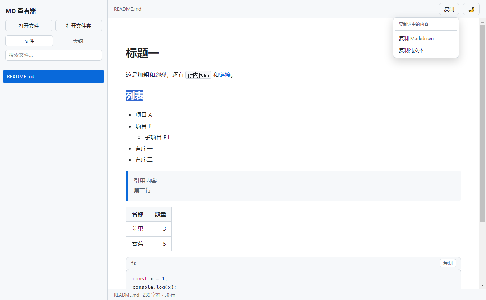

# MD Viewer

[](https://github.com/2642086672/markdown-viewer/actions/workflows/build.yml)
[](https://github.com/2642086672/markdown-viewer/releases/latest)

一款轻量、纯本地、零第三方运行时依赖的 Markdown 阅读器，基于 Electron 构建。支持 Windows 与 macOS。



<details>
<summary>暗色主题截图</summary>


</details>

## 功能

- **完整 Markdown 渲染**：标题、列表、表格、代码块高亮、引用、任务列表、图片、链接
- **灵活复制**（v1.1.0 新增）：工具栏「复制」支持两种格式、两种范围
  - 复制 Markdown：整篇文档复制原始源文；选中内容时从渲染结果还原 Markdown
  - 复制纯文本：不带任何 Markdown 标记，保留段落、列表符号与表格
  - 有选中文字时只复制选中部分，否则复制整篇文档
- **文件夹模式**：文件列表、大纲导航、文件名搜索
- **本地图片**：自动解析 Markdown 中的相对路径图片，无需联网
- **明暗主题**：一键切换，记忆偏好
- **代码块复制**：每个代码块都有独立复制按钮
- **拖拽打开**：把 `.md` 文件或整个文件夹拖进窗口即可
- **纯本地**：不联网、不上传任何内容

## 下载

前往 [Releases](https://github.com/2642086672/markdown-viewer/releases/latest) 下载：

| 平台 | 文件 |
| --- | --- |
| Windows x64 | `MD-Viewer-1.1.1-x64.exe` |
| macOS Intel (x64) | `MD-Viewer-1.1.1-x64.dmg`（或 `-x64.zip`） |

### macOS 说明

安装包没有 Apple 开发者签名和公证（`未签名`）。首次打开时 macOS 会拦截，请任选其一：

1. 在 Finder 中右键点击 App →「打开」→ 再次确认「打开」
2. 或执行：

```bash
xattr -dr com.apple.quarantine "/Applications/MD Viewer.app"
```

## 使用

- 点击「打开文件」/「打开文件夹」，或直接拖入文件（夹）
- 工具栏「复制」→「复制 Markdown」或「复制纯文本」
- 内容区选中文字后，复制菜单会变成仅复制选中部分
- 快捷键：`Ctrl/Cmd+O` 打开文件，`Ctrl/Cmd+Shift+O` 打开文件夹，`Ctrl/Cmd+T` 切换主题

## 开发

需要 Node.js 20+。

```bash
npm install
npm start
```

## 构建

```bash
npm run dist:win        # Windows x64 安装包（NSIS）
npm run dist:mac-x64    # macOS Intel (x64) dmg + zip（需在 macOS 环境执行）
npm run dist:mac-arm64  # macOS Apple Silicon
```

GitHub Actions 会在推送 `v*` 标签时自动构建 **Windows x64** 与 **macOS Intel (x64)**，并把安装包附加到对应的 GitHub Release。

## 项目结构

```
├─ main.js               # Electron 主进程、菜单、文件读取 IPC
├─ preload.js            # 安全桥接（contextIsolation）
├─ md-viewer.html        # 全部界面与 Markdown 渲染/复制逻辑（内联 CSS/JS）
├─ assets/icon.png       # 运行时窗口图标
├─ build/icon.png        # 打包图标（1024×1024）
├─ .github/workflows/    # CI：Windows + macOS Intel 构建与发布
└─ docs/                 # 截图等文档资源
```

## English

MD Viewer is a lightweight, fully local Markdown viewer built with Electron. It renders Markdown offline, supports folder browsing, outline navigation, code highlighting and light/dark themes. Version 1.1.0 adds **copy as Markdown** and **copy as plain text**, for either the whole document or the current selection.

Download the Windows x64 installer or the macOS Intel (x64) dmg from [Releases](https://github.com/2642086672/markdown-viewer/releases/latest). The macOS build is unsigned; on first launch use right-click → Open, or remove the quarantine attribute.

## 许可证

[Apache License 2.0](LICENSE) © 2026 MarcusLong